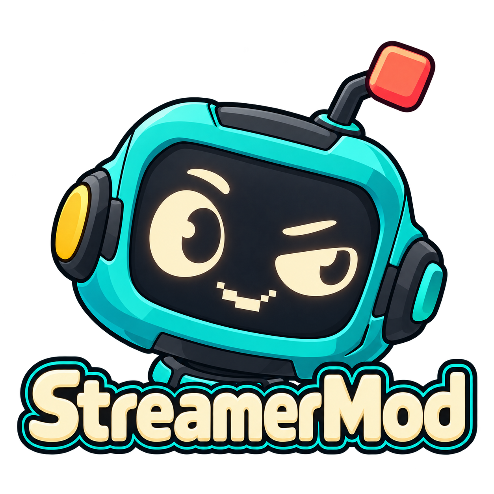

<div align="center">
  
  <h1>StreamerMod</h1>
  <p><strong>Streaming-Automation für Linux – Actions, Twitch, YouTube, OBS und KI in einer nativen Oberfläche.</strong></p>
  <p>
    
    
    
  </p>
</div>

**StreamerMod verbindet Stream-Ereignisse mit frei zusammensetzbaren Aktionen.** Eine Chatnachricht kann eine Begrüßung auslösen, ein Raid einen KI-Text und OBS-Alert erzeugen, eine Kanalpunkte-Einlösung ein Mikrofon zeitweise stummschalten. Die Bedienung erfolgt über eine native Qt-Oberfläche; ein Browser ist zur normalen Programmbedienung nicht nötig.

Das Projekt ist aus einer Linux-Migration entstanden und orientiert sich an vertrauten Konzepten von Streamer.bot: **Actions, Triggers und Sub-Actions**. Es ist ein eigenständiges Community-Projekt und kein offizielles Produkt von Streamer.bot, Twitch, YouTube, OBS oder Elgato.

> **Entwicklungsstand:** Funktionen werden laufend geprüft und erweitert. Es gibt keine pauschale Zusage vollständiger Originalkompatibilität oder einer praktischen Abnahme aller Plattformereignisse und Geräte. Bitte neue/importierte Actions zunächst kontrolliert testen.

## Was kann StreamerMod?

| Bereich | Möglichkeiten |
|---|---|
| **Actions und Logik** | Trigger, Unteraktionen, Gruppen, Bedingungen, Variablen, Queues, Timer, Chatbefehle sowie Import/Export im unterstützten Umfang |
| **Twitch** | Chat und Chatreaktionen, Follow-/Raid-/Abo-Ereignisse, Kanalpunkte, Umfragen, Vorhersagen, Hype Train und weitere Kanal-/Moderationsfunktionen – jeweils abhängig von Kontorechten und Twitch-Verfügbarkeit |
| **YouTube, optional** | Separate Anmeldung, Live-Chat sowie unterstützte Chat-/Kanalereignisse und Unteraktionen; Twitch und YouTube können gemeinsam verwendet werden |
| **OBS Studio** | Szenen, Quellen, Text, Sichtbarkeit, Medien, Audio und Streaming-/Aufnahmefunktionen über OBS WebSocket |
| **KI** | Lokaler kompatibler KI-Server oder OpenAI API, zentrale Prompts, benutzerdefinierte Aufträge und automatisch übergebene Ereignis-/Nutzerinformationen |
| **Spracherkennung** | Lokale Whisper-Erkennung, alternativ Vosk; erkannte Sprache kann passende Actions auslösen |
| **Linux-Audio** | Lautstärke und Stummschaltung für Geräte und laufende Anwendungen über PulseAudio/PipeWire-Pulse |
| **Zeitaktionen** | Einen Buchstaben A–Z zeitweise sperren; Mikrofon oder Audioausgabe zeitweise stummschalten und den vorherigen Zustand wiederherstellen |
| **Stream Deck** | Eigenes StreamerMod-Plugin für separat laufendes OpenDeck; Tasten-/Regler-/Touch-Ereignisse und Deck-Unteraktionen im unterstützten Umfang |
| **Netzwerk und Erweiterungen** | Lokale Webhooks, WebSocket-/HTTP-/UDP-Funktionen, direkte StreamerMod-Remote-Verbindungen und Discord-Nachrichten per Webhook |
| **C# und Hilfsfunktionen** | C#-Actions mit .NET 10, unterstützte CPH-APIs, Datei-/Prozessaktionen, Credits und projektbezogene Sicherungen |

Der aktuelle Katalog umfasst mehr als 270 native Unteraktionen und mehr als 240 Triggerarten. Die Anzahl ist ein Inventar des vorhandenen Codes, keine Live-Abnahme jeder Einzelwirkung.

## Schnell installieren

### Voraussetzungen

- Linux mit apt: Debian 12/13, Ubuntu 24.04 oder neuer bzw. passende Derivate. **Praktischer Entwicklungsrechner: Debian 13.** Andere Systeme sind nicht pauschal abgenommen.
- x86_64 oder arm64; einzelne Python-/Drittanbieterpakete müssen für die Architektur verfügbar sein.
- Mindestens etwa 4 GB freier Speicher für Python-Umgebung, SDK und Sprachmodell.
- Internetzugang und einmalige Administratorrechte für Systempakete und den Tastensperrdienst.
- Für die Oberfläche eine laufende Desktop-Sitzung. Für lokale Spracherkennung ausreichend RAM/CPU; das Standardmodell ist für CPU-Betrieb eingerichtet.

Repository klonen oder das Quellpaket entpacken, dann als **normaler Desktop-Benutzer** starten:

```sh
git clone https://github.com/sorgonas/StreamerMod.git
cd StreamerMod
bash install.sh
```

Der Installer fordert nur für den Systemteil Administratorrechte an. **Die Anwendung und ihre Python-Umgebung werden nicht als root installiert oder gestartet.**

### Was automatisch eingerichtet wird

1. Benötigte Python-, Qt-, Audio-, Video- und Build-Systempakete.
2. Eine eigene Installation unter `~/.local/share/streamermod` samt virtueller Python-Umgebung und den Abhängigkeiten für Desktop, Audio, Tastatur, Kamera, Spracherkennung und YouTube.
3. Das **.NET-10-SDK**, sofern nicht vorhanden. Der offizielle Microsoft-Download wird anhand der SHA512 aus den Release-Metadaten geprüft.
4. **Whisper Base** für lokale Spracherkennung mit fester Modellrevision und Prüfsummenprüfung. Das Mikrofon wird dabei nicht aktiviert.
5. **keyd und der eingeschränkte StreamerMod-Tastensperrdienst** für den installierenden Benutzer. Bei fehlendem Distributionspaket wird eine feste offizielle keyd-Version mit SHA256-Prüfung gebaut. Vorhandene fremde keyd-Konfigurationen werden nicht überschrieben.
6. OBS Studio, falls weder eine native Installation noch das offizielle OBS-Flatpak erkannt wird.
7. Ein Starter im Anwendungsmenü und `~/.local/bin/streamermod`.

**Es werden keine Konten verbunden, keine Streamkeys übernommen und keine Streams gestartet.** Vorhandene Zielkonfigurationen bleiben bei erneuter Installation erhalten. Eine bestehende OBS-Installation und ihre Szenen werden nicht importiert oder verändert.

### Optionen

```sh
# Vollständigen Plan anzeigen, ohne etwas zu installieren:
bash install.sh --dry-run

# OpenDeck zusätzlich unabhängig installieren und eigenes Plugin einrichten:
bash install.sh --with-opendeck

# Eigenen Installationsordner wählen:
bash install.sh --prefix "$HOME/Programme/StreamerMod"

# Größere Downloads später nachholen:
bash install.sh --without-models --without-dotnet

# Tastensperrdienst ausdrücklich auslassen:
bash install.sh --without-keyguard
```

`--without-obs` verhindert eine neue OBS-Installation. `--skip-system --without-keyguard` ist für Systeme gedacht, deren Pakete und Dienste bereits administrativ vorbereitet wurden. Alle Optionen: `bash install.sh --help`.

OpenDeck bleibt ein eigenes Programm mit eigenem Editor und eigenen Profilen. Die Option installiert keine beliebigen Marketplace-Plugins und verspricht keine automatische Windows-Plugin-Konvertierung.

## Erster Start

StreamerMod über das Anwendungsmenü öffnen oder ausführen:

```sh
~/.local/share/streamermod/StreamerMod
```

1. **Twitch:** Eigene Twitch-Anwendung und Broadcaster-Konto einrichten; ein separates Bot-Konto ist optional. Zusätzliche Rechte müssen am jeweils betroffenen Konto bestätigt werden.
2. **YouTube, falls benötigt:** Eigene Google-OAuth-Desktop-Anwendung mit aktivierter YouTube Data API einrichten. Ein separates Bot-Konto ist optional. Livestream-Freigabe, API-Limits und Ereignisverfügbarkeit bestimmt YouTube.
3. **OBS:** WebSocket-Adresse und Passwort selbst eintragen und verbinden. StreamerMod erzeugt keine eigene Streamkey-Konfiguration. Multistream-Ausgänge werden in OBS bzw. dessen Zusatzlösung eingerichtet.
4. **KI, falls benötigt:** Lokalen Server oder OpenAI API auswählen und Modell/Zugang einrichten. Ein lokaler LLM-Server und große Chatmodelle werden nicht automatisch installiert.
5. **Actions:** Trigger und Unteraktionen verknüpfen. Mit einem ungefährlichen Test beginnen und tatsächliche Ausgaben im Verlauf prüfen.

Der frische Stand enthält keine persönlichen Konten, Actions, Chatbefehle, OBS-Szenen, Medien, Prämien oder Verläufe. Externe Verbindungen sind anfangs ausgeschaltet bzw. unkonfiguriert.

## KI-Prompts und automatische Daten

Es gibt elf zentrale Vorlagen: **Grundverhalten, Chat, Willkommen, Follow, Abo, Raid, Shoutout, Zufallsbeitrag, Clip-Kommentar, Streamtitel und Screenshot-Kommentar.** Sie sind allgemeine Vorschläge, keine auf einen bestimmten Kanal festgelegte Persönlichkeit. Nur benötigte Vorlagen verwenden.

Eine KI-Unteraktion wählt die vorhandene Vorlage und eine Antwortvariable aus. Nur **Benutzerdefiniert** öffnet einen eigenen Prompttext. Anbieter, Server und Modell stammen aus den zentralen Einstellungen; die Vorlage wird in der Action nicht nochmals als bearbeitbare Kopie angelegt.

Ereignisdaten und Ergebnisse vorausgehender Abfragen werden automatisch als Kontext übergeben. Für einen personalisierten Raid beispielsweise zuerst **Twitch → User → Get User Info for Target**, anschließend den KI-Schritt ausführen:

| Variable | Bedeutung |
|---|---|
| `%user%`, `%userName%` | Anzeigename bzw. Login des auslösenden Nutzers |
| `%viewers%` | Zuschauerzahl des eingehenden Raids |
| `%game%` | Eingestellte Kategorie des zuvor abgefragten Zielkanals |
| `%targetGame%` | Zusätzlicher Alias für diese Zielkategorie |
| `%targetChannelTitle%` | Titel des abgefragten Kanals |
| `%targetChannelDescription%` | Kanalbeschreibung; `%targetDescription%` bleibt ebenfalls verfügbar |

Eine eingestellte Kategorie ist keine vollständige Spielhistorie. Fehlende Informationen dürfen nicht als belegte Fakten ergänzt werden. Ein separat erzeugter KI-Text lässt sich anschließend identisch im Chat und in OBS verwenden.

## Zeitliche Tastensperre und Stummschaltung

Unter **Core → System → Keyboard** lässt sich ein einzelner Buchstabe für **1–600 Sekunden** sperren. Groß-/Kleinschreibung bezeichnen dieselbe physische Taste; das gewählte Layout berücksichtigt die deutsche Y/Z-Zuordnung. Es gibt keinen beliebigen Shell- oder Tastenbindungszugang über den Dienst.

Unter **Core → System → Linux Audio** können Mikrofon oder Wiedergabe zeitweise stummgeschaltet werden. `@default` betrifft das Standardgerät, `@all` alle aktuell vorhandenen Geräte der Zielart. Nach der Frist wird der vorherige Stummzustand wiederhergestellt. Mehrere aktive Timer werden berücksichtigt; die optionalen „Early“-Unteraktionen dienen nur zum vorzeitigen Abbrechen.

Diese Bausteine können mit Kanalpunkte-Einlösungen verbunden werden. Der Installer erzeugt keine echten Prämien. Tastensperren laufen im Systemdienst aus; Audio-Wiederherstellung erfolgt in der Anwendung. Nach einem erzwungenen Prozessabbruch oder Stromausfall kann eine Audio-Wiederherstellung nicht zugesagt werden.

## Stream Deck, OBS und ergänzende Programme

Das vorhandene Stream Deck + wurde mit OpenDeck praktisch erprobt, einschließlich Wiederanschluss, Tasten, Drehregler und Touch. Weitere Modelle und mehrere Geräte sind nicht pauschal physisch abgenommen. Für die eigene StreamerMod-Belegung wird das Plugin unter `assets/opendeck` verwendet. Geräte-/Profilkonfiguration bleibt im separaten OpenDeck-Editor.

StreamerMod-Remote verwendet ein eigenes direktes Protokoll; es ist keine Anmeldung an der Original-Streamer.bot-Website. Discord wird über einen konfigurierten Webhook angesprochen. Streamfog bleibt eine eigenständige Anwendung und kann über OBS verwendet werden. Nicht vorhandene weitere Elgato-Geräte und MCP werden nicht als fertige Standardfunktionen angeboten. Kick ist nicht Bestandteil des vorgesehenen Plattformumfangs.

## Diagnose und Updates

```sh
# Installierte Abhängigkeiten prüfen, ohne Chatnachricht oder Stream:
~/.local/share/streamermod/.venv-linux/bin/python \
  ~/.local/share/streamermod/tools/check_installation.py
```

Ohne heruntergeladenes Modell oder SDK die passenden `--without-models`-/`--without-dotnet`-Optionen ergänzen. Action-Fehler erscheinen im Verlauf und in den lokalen Logs. Vor einer Weitergabe Logs und Screenshots auf private Inhalte prüfen.

Für ein Update den neuen Quellstand herunterladen und `bash install.sh` erneut ausführen. Vorhandene Benutzerkonfigurationen bleiben erhalten. Automatische Kontofreigaben oder unbeaufsichtigte Programmstarts werden dadurch nicht eingerichtet.

## Datenschutz und Sicherheit

Persönliche Konfigurationen, Tokens, Datenbanken, Backups, Importpakete, Chatverläufe und Medien gehören **nicht ins Repository**. Der Export über `tools/build_clean_distribution.py` arbeitet mit einer festen Dateiliste und neutralen Erstwerten statt mit einer Kopie aktiver Konten. Siehe [SECURITY.md](SECURITY.md) und [BEREINIGUNG.md](BEREINIGUNG.md).

C#-Code und importierte Actions können Dateien, Programme und Dienste steuern. Nur vertrauenswürdige Actions ausführen. Lokale Dienste nicht ohne eigene Authentifizierung und geschützten Transport ins Internet freigeben.

## Gemeinsam weiterentwickeln

**Beiträge sind willkommen.** Über [Issues](https://github.com/sorgonas/StreamerMod/issues) Fehler oder Vorschläge beschreiben, einen Fork anlegen und Änderungen als Pull Request einreichen. Bitte bei Tests nennen, ob echte Plattformereignisse/Geräte verwendet oder Daten simuliert wurden. Weitere Hinweise: [CONTRIBUTING.md](CONTRIBUTING.md).

## Lizenz und Projektgrenzen

Eigener StreamerMod-Code: **GNU GPL-3.0**, siehe [LICENSE](LICENSE). Die Lizenz ermöglicht offene Weiterentwicklung; bei Weitergabe abgeleiteter Software gelten ihre Bedingungen.

Drittanbieter bleiben unter ihren eigenen Bedingungen. **mXparser 6.1.0 besitzt eine gesonderte nichtkommerzielle/kommerzielle Dual License.** Die GPL des eigenen Codes erteilt keine zusätzliche kommerzielle Erlaubnis für diese Bibliothek. Vollständige Hinweise: [THIRD-PARTY-NOTICES.md](THIRD-PARTY-NOTICES.md) und [Spracherkennung](THIRD-PARTY-SPEECH.md).

Dieses Projekt befindet sich in aktiver Entwicklung. Vollständige Originalkompatibilität, sämtliche fremden Geräte/Plugins und jede Twitch-/YouTube-Schreibwirkung sind nicht pauschal live abgenommen. Softwaretests, simulierte Ereignisse und echte Geräte-/Plattformtests werden ausdrücklich unterschieden.

---

**English:** StreamerMod is a native Linux streaming-automation desktop app for actions, Twitch, optional YouTube, OBS, AI responses, local speech recognition, Linux audio and OpenDeck integration. Run `bash install.sh --help` for installation options. Contributions through issues and pull requests are welcome. Original project code is GPL-3.0; bundled third-party components retain their own license terms.

